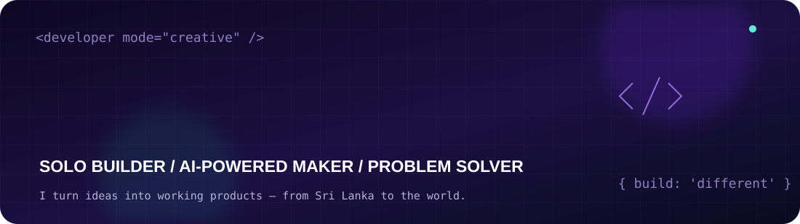

<div align="center">



### I don't just write code. I turn unusual ideas into useful products.

**Independent Developer** · **Creative Problem Solver** · **AI-Augmented Builder** · **Sri Lanka 🇱🇰**

[](https://htgbiz.com/works)
[](https://htgbiz.com)
[](mailto:support@htgbiz.com)

</div>

---

## ⚡ The way I build

> **Solo by default. AI-powered by design. Built to solve real problems.**

Hey, I'm **Harry** 👋 — a creative project builder who enjoys finding **original solutions to everyday business problems** and turning them into products people can actually use.

I handle most projects **independently, from idea to deployment**. For certain projects, I collaborate with another developer or specialist, usually keeping the team to **two people or fewer**. My typical workflow is a **one-person development team + AI tools + carefully crafted prompts**.

AI helps me explore, prototype, troubleshoot, and move faster. **The vision, decisions, integration, testing, and responsibility for the final product remain mine.**

```text
💡 A problem worth solving
      ↓
🧠 Understand the workflow + invent a simpler approach
      ↓
🤖 Prompt, prototype, review, refine
      ↓
🛠️ Build the real system: UI + APIs + database + automation
      ↓
🚀 Ship, learn, improve, repeat
```

<div align="center">

**90% solo + AI-assisted building** &nbsp; • &nbsp; **Small teams when needed** &nbsp; • &nbsp; **Always focused on working solutions**

</div>

## 🚀 Selected work

*These are client and business solutions; not all source code is public.*

| Project | What I built / contributed to |
|:--|:--|
| 🎮 **[HTG TopUp Commerce Platform](https://htgbiz.com/works/htg-topup-commerce-platform)** | Automated digital-product store with payments, wallet balance, redeem codes, order workflows, and instant delivery. |
| 🧾 **[360 Accountants](https://360accountants.lk)** | Professional accounting and business-services website focused on helping clients find tax, audit, and registration services. |
| 🎉 **[MDECOR](https://htgbiz.com/works)** | UK event-decor website with inquiries and back-office tools for orders, teams, inventory, and event workflows. |
| 🛒 **[Mr Cherry](https://htgbiz.com/works)** | Reimagined e-commerce experience with a custom interface, product tools, wishlists, comparisons, and PDF features. |
| 🌏 **[Duoluxus](https://htgbiz.com/works)** | E-commerce implementation combining store operations with warehouse, payment, and Telegram automation. |
| 🖼️ **[SNT Frames](https://htgbiz.com/works)** | Printing business website and operations system with POS, WhatsApp messaging, and accounting-related automation. |

**→ [More projects, case studies, and live work at HTGBIZ.COM](https://htgbiz.com/works)**

## 🧩 Problems I like solving

<table>
<tr>
<td width="50%" valign="top">

**💳 Payments & Commerce**

Wallets, top-ups, checkout flows, payment integrations, order fulfillment, and online stores.

</td>
<td width="50%" valign="top">

**⚙️ Business Systems**

POS, inventory, reporting, dashboards, operational tools, and internal automations.

</td>
</tr>
<tr>
<td valign="top">

**📱 Apps & Platforms**

Responsive websites, mobile experiences, role-based applications, and customer portals.

</td>
<td valign="top">

**🤖 AI-Assisted Engineering**

Prompt-driven prototyping, rapid iteration, practical AI workflows, and custom integrations.

</td>
</tr>
</table>

## 🛠️ Tools in my workshop

<div align="center">


</div>

## ✨ My developer philosophy

```javascript
const harry = {
  mindset: "Find the problem. Build a better way.",
  role: "Independent product builder",
  team: "Usually me + AI; occasionally one collaborator",
  superpower: "Connecting creativity, prompts, and engineering",
  favoriteOutput: "A real product that makes someone's work easier",
  shipping: true,
};
```

**I care more about a solution that works than a complicated stack that looks impressive.**

---

<div align="center">

### Have a difficult idea or an inefficient workflow?

**Let's turn it into something real.**

[**View My Portfolio ↗**](https://htgbiz.com/works) &nbsp;·&nbsp; [**HTG BIZ ↗**](https://htgbiz.com) &nbsp;·&nbsp; [**Email Me ↗**](mailto:support@htgbiz.com)

<sub>Designed to build differently. Created by Harry. 💜</sub>

</div>
